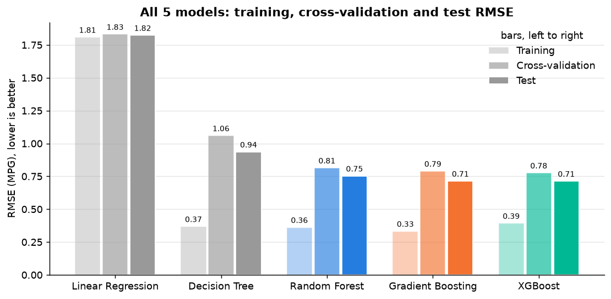

# ROUTEX: Machine-Learning-Based Vehicle Fuel Consumption Prediction

## Final Project Report

### 1. Project and group information

| Item | Details |
|---|---|
| Project title | ROUTEX: Machine-Learning-Based Vehicle Fuel Consumption Prediction |
| Group number | 48 |
| Course / module | To be confirmed by the group |
| Supervisor | To be confirmed by the group |
| Meeting / allocation slot shown in group record | 19 November 2026, 5:10 PM–5:30 PM |
| Repository | https://github.com/harshaprasad599651-prog/ROUTEX |

**Group member student IDs**

| Member | Student ID | Name |
|---|---|---|
| Member 1 | EG/2023/5695 | To be added |
| Member 2 | EG/2023/5515 | To be added |
| Member 3 | EG/2023/5904 | To be added |
| Member 4 | EG/2023/5551 | To be added |

The supplied group record contains the four student IDs but does not show the members' names, course/module name or supervisor name. Those fields must be confirmed rather than guessed.

### 2. Abstract

ROUTEX is a supervised machine-learning regression project that estimates a vehicle's combined fuel economy (`comb08`) in miles per gallon (MPG) from technical and descriptive vehicle specifications. The project inspects and preprocesses the U.S. vehicle fuel-economy dataset, explores relationships in the data, and compares five regression models. The supplied results show that XGBoost has the lowest five-fold cross-validation RMSE (0.77558 MPG) and the lowest held-out test RMSE (0.71261 MPG), with a test R² of 0.98242. Gradient Boosting is a very close second on the test set.

### 3. Problem statement and objectives

Fuel economy is normally measured through standardised testing. ROUTEX investigates whether combined fuel economy can be estimated from vehicle specifications before a test result is available.

**Research question:** How accurately can machine-learning regression models predict `comb08` from vehicle specifications, and which of the tested models provides the strongest performance?

Objectives:
1. Inspect the dataset and identify quality issues.
2. Build a reproducible preprocessing pipeline and avoid target leakage.
3. Explore the relationships between vehicle specifications and fuel economy.
4. Train and evaluate Linear Regression, Decision Tree, Random Forest, Gradient Boosting and XGBoost.
5. Compare the models using consistent train/test data and cross-validation.
6. Provide a simple prediction prototype using the selected model.

### 4. Dataset and preprocessing

The project uses `vehicles.csv`, a U.S. vehicle fuel-economy dataset described in the original project report as sourced from fueleconomy.gov / U.S. Department of Energy and EPA, with the project copy obtained from the public `ajhenry/searchable-car-database` repository.

| Dataset item | Value |
|---|---|
| Original dataset size | 42,774 rows × 83 columns |
| Model years | 1984–2021 |
| Prediction target | `comb08` |
| Target unit | MPG |
| Pure electric vehicles excluded | 241 |
| Duplicate records removed | 40 |
| Cleaned modelling dataset | 42,493 rows |
| Model input features | 22 |
| Training rows | 33,994 |
| Test rows | 8,499 |
| Split | 80/20, random_state = 42 |

Pure battery-electric vehicles were excluded because their combined rating is MPGe, which is not directly comparable with MPG. Duplicate records were removed while retaining valid vehicle records. Columns derived from fuel-economy test outcomes, such as city/highway MPG and fuel-cost or CO₂ measures, were removed to prevent target leakage. Feature transformations and learned imputations are fitted within the scikit-learn pipeline on training data only.

#### Passenger-volume data-quality decision

The Member 3 data-quality script identified **9 records** with passenger volume below 40 cubic feet. These values were treated as implausible data-entry values and converted to missing values rather than deleting the vehicle rows. This preserves the dataset rows and the fixed train/test split. The model pipeline then imputes missing passenger volume using the training-set median. Evidence is saved in `results/member3_passenger_volume_issues.csv` and `reports/figures/06_passenger_volume_fix.png`; the decision is documented in `reports/member3_data_quality.md`.

### 5. Modelling methodology

Five regression models were compared:
- Linear Regression
- Decision Tree Regressor
- Random Forest Regressor
- Gradient Boosting (`HistGradientBoostingRegressor`)
- XGBoost (`XGBRegressor`)

The Member 3 experiment retrained all five models on the same corrected data and same 80/20 split. Five-fold shuffled cross-validation was used for model assessment and hyperparameter selection. The saved summary records 12 randomized search candidates per boosting model. The final test set contains 8,499 vehicles and is used for the final comparison.

### 6. Results and model comparison

Results below are taken from `results/member3_model_metrics.csv` and `results/member3_training_summary.json`.

| Model | CV RMSE (MPG) | Test MAE (MPG) | Test RMSE (MPG) | Test R² |
|---|---:|---:|---:|---:|
| Linear Regression | 1.83097 | 1.28296 | 1.82269 | 0.88497 |
| Decision Tree | 1.05883 | 0.46661 | 0.93514 | 0.96972 |
| Random Forest | 0.81379 | 0.47639 | 0.75219 | 0.98041 |
| Gradient Boosting | 0.78897 | 0.47032 | 0.71342 | 0.98238 |
| **XGBoost** | **0.77558** | 0.48276 | **0.71261** | **0.98242** |

**Selected model: XGBoost.** It achieved the lowest cross-validation RMSE and the lowest test RMSE among the five candidates. Gradient Boosting is extremely close: its test RMSE is 0.71342 MPG compared with 0.71261 MPG for XGBoost. XGBoost's test MAE (0.48276 MPG) is not the lowest; Gradient Boosting and Decision Tree have slightly lower MAE. The selection is therefore based on the lowest CV RMSE and test RMSE, not on every metric being best.

The baseline that predicts the training-set mean has a test RMSE of 5.37613 MPG and R² of approximately -0.00071, so all five trained models substantially outperform the baseline.



### 7. Interpretation, limitations and risks

The saved Member 3 result files include predicted-versus-actual plots, residual plots and feature-importance output. These support inspection of model fit and the contribution of the input features.

Important limitations:
1. Pure battery-electric vehicles are outside the current model scope because the target used is MPG rather than MPGe.
2. The source dataset in this project snapshot covers model years only through 2021.
3. Random train/test performance may be more optimistic than performance on entirely unseen makes and models. The earlier evaluation report recorded a grouped-CV Random Forest RMSE of about 1.30 MPG; a matching grouped-CV result for the final XGBoost model is not supplied in the current result files.
4. Hybrid and small vehicle subgroups may have fewer examples and less reliable estimates.
5. The model does not include every factor affecting fuel economy, such as vehicle weight, aerodynamics, driving conditions and maintenance.
6. The prototype provides an estimate for learning and demonstration. It is not an official EPA rating and should not be used as a substitute for certified fuel-economy information.
7. The saved `joblib` model was created with the project's recorded Python / scikit-learn / XGBoost environment. Loading serialized estimators with substantially different library versions can produce compatibility warnings or errors.

### 8. Prototype and demonstration

A Streamlit prototype is provided at `app/streamlit_app.py`. It collects vehicle specifications, loads `models/xgboost.joblib`, applies the same passenger-volume plausibility rule, and displays a predicted combined MPG value.

Run from the repository root after installing `requirements.txt` and ensuring the XGBoost model artifact exists:

```bash
streamlit run app/streamlit_app.py
```

If the model artifact is missing, run the full model-training script first:

```bash
python -m src.member3_advanced_models
```

The full training run performs hyperparameter search and may take a substantial amount of time. The `--quick` option is intended only as a pipeline check and should not be used to replace the reported full-run metrics.

### 9. Reproducibility and project execution

Install dependencies:

```bash
python -m pip install -r requirements.txt
```

Run the notebooks in order:
1. `notebooks/01_dataset_inspection.ipynb`
2. `notebooks/02_preprocessing.ipynb`
3. `notebooks/03_exploratory_data_analysis.ipynb`
4. `notebooks/04_model_training.ipynb`
5. `notebooks/05_model_evaluation.ipynb`

Run the Member 3 scripts from the repository root:

```bash
python -m src.member3_data_quality
python -m src.member3_advanced_models
```

The raw dataset must be placed at `data/raw/vehicles.csv`.

### 10. Conclusion

ROUTEX demonstrates that vehicle specifications can be used to predict combined fuel economy with strong performance on the supplied held-out test set. Across the five compared regression models, XGBoost achieved the lowest five-fold cross-validation RMSE (0.77558 MPG), test RMSE (0.71261 MPG) and a test R² of 0.98242. Gradient Boosting performed almost identically on the test set. XGBoost is selected as the final model based on the combined cross-validation and test RMSE results. The prediction prototype makes the trained model accessible for a simple demonstration, while the limitations above should be considered when interpreting predictions.

---

**Administrative fields still requiring confirmation:** course/module name, supervisor name and member names. Student IDs and group number are transcribed from the supplied group allocation screenshot.
